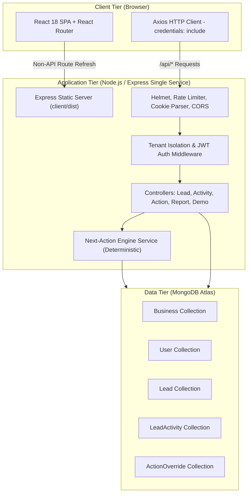

# ActiLynq — System Architecture Document

## 1. Architectural Overview

ActiLynq is engineered as a unified, single-service MERN web application:
- **Client:** React 18 single-page application built with Vite and Tailwind CSS.
- **Server:** Node.js (ES Modules) Express application serving RESTful API routes under `/api` and hosting the production React build as static assets.
- **Database:** MongoDB Atlas (M0 free cluster) with Mongoose object data modeling.
- **Authentication:** Stateless signed JSON Web Tokens (JWT) stored in secure, HttpOnly, SameSite cookies.



---

## 2. Multi-Tenant Data Isolation Architecture

ActiLynq provides strict business-level multi-tenancy:
1. **Never Trust Client Inputs:** The client browser is never permitted to pass a `businessId` in request bodies, query strings, or URL parameters.
2. **Session Context Derivation:** Upon login or registration, the server issues a JWT containing `{ userId, businessId, role }`.
3. **Middleware Verification:** `requireAuth` parses and verifies the HttpOnly cookie, fetches the corresponding user and business documents, and attaches:
   ```javascript
   req.user = {
     _id: user._id,
     businessId: business._id, // Enforced tenant boundary
     isDemo: business.isDemo
   };
   ```
4. **Guaranteed Scoping in All Queries:** Every Mongoose query, update, or deletion enforces `{ businessId: req.user.businessId }`.
5. **Cross-Tenant Access Denial:** Attempting to query or modify another agency's lead returns a `404 Not Found` (preventing ID enumeration) or `403 Forbidden`.

---

## 3. Database Models & Schema Structure

### `Business`
- `name`: String (Agency name)
- `businessType`: 'travel_agency'
- `currency`: Default 'INR'
- `isDemo`: Boolean (Index: true — guards demo reset capability)
- `ownerUserId`: ObjectId (ref: User)

### `User`
- `name`: String
- `email`: Normalized lowercase unique string
- `passwordHash`: Bcrypt hash (salt rounds: 10)
- `businessId`: ObjectId (ref: Business, Index: true)
- `role`: 'owner'

### `Lead`
- `businessId`: ObjectId (ref: Business, Index: true)
- `createdBy`: ObjectId (ref: User)
- `customerName`: String (Required)
- `phone`: String (Required, normalized)
- `email`: String (Optional, nullable)
- `destination`: String (Optional, nullable)
- `departureCity`: String (Optional, nullable)
- `travelStartDate`: Date (Optional, nullable)
- `travelEndDate`: Date (Optional, nullable)
- `travellerCount`: Number (Optional, nullable, min: 1 — never defaulted to 1)
- `budgetAmount`: Number (Optional, nullable — does not block quotes)
- `budgetCurrency`: String (Default: 'INR')
- `travelType`: Enum (leisure, honeymoon, family, adventure, business, group, other)
- `accommodationPreference`: Enum (budget, 3_star, 4_star, 5_star, resort, homestay, any)
- `stage`: Enum of 9 travel workflow stages
- `quotationAmount`: Number (Optional, captured upon quotation sent)
- `quotationSentAt`: Date (Optional, index: true)
- `nextFollowUpAt`: Date (Optional, index: true)
- `lastActivityAt`: Date (Updated on all activities, notes, and edits)
- `lastCustomerContactAt`: Date (Updated *only* on confirmed customer outreach)
- `lostReason`: String (Required when marked as lost)
- `isArchived`: Boolean (Index: true)

### `LeadActivity`
- `businessId`: ObjectId (Index: true)
- `leadId`: ObjectId (Index: true)
- `userId`: ObjectId
- `type`: Enum (call, whatsapp, email, meeting, note, quotation_sent, stage_change, etc.)
- `title`: String
- `description`: String
- `occurredAt`: Date
- `isCustomerContact`: Boolean (Derived strictly by server logic from type & outcome)
- `metadata`: Mixed object (fromStage, toStage, contactOutcome, quotationAmount)

### `ActionOverride`
- `businessId`: ObjectId
- `leadId`: ObjectId
- `ruleId`: String
- `snoozeUntil`: Date
- `reason`: String
- **Compound Unique Index:** `{ businessId: 1, leadId: 1, ruleId: 1 }` (guarantees idempotency)

---

## 4. Next-Action Engine Execution Lifecycle

1. Client requests `GET /api/actions`.
2. Controller fetches non-terminal leads:
   `Lead.find({ businessId: req.user.businessId, isArchived: false, stage: { $nin: ['booking_confirmed', 'lost'] } })`.
3. Controller fetches active snooze overrides:
   `ActionOverride.find({ businessId: req.user.businessId, snoozeUntil: { $gt: now } })`.
4. Engine evaluates each lead sequentially against rules 1 through 5.
5. First matching rule that is not snoozed is returned (max 1 action per lead).
6. Recommendations are sorted by Priority (High $\rightarrow$ Medium $\rightarrow$ Low) and due time.
7. Returned to client with human-readable rationales.
